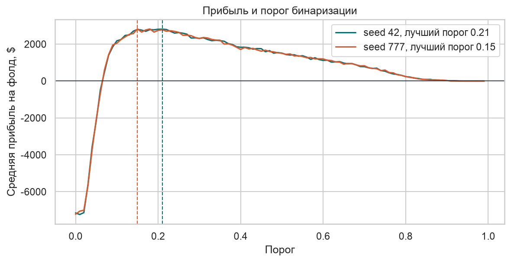
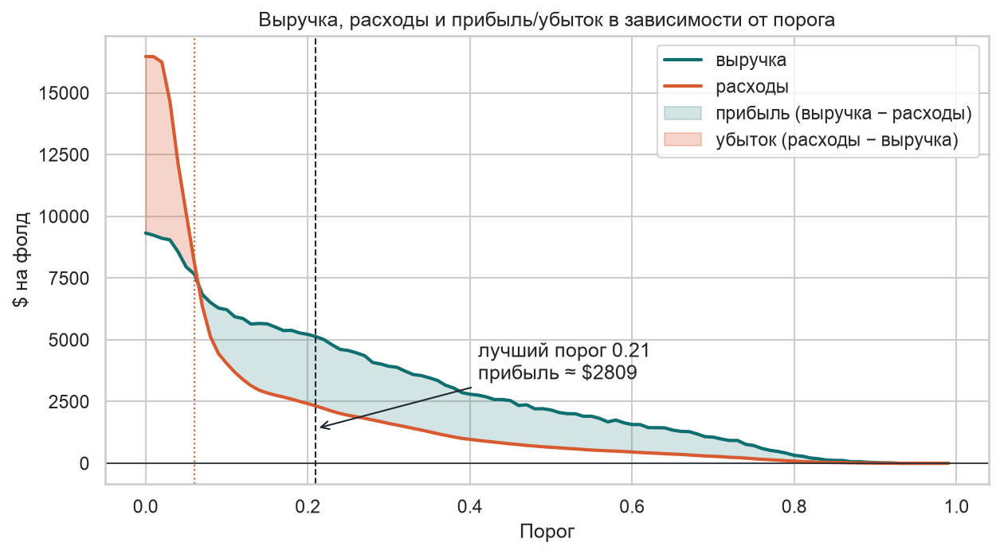
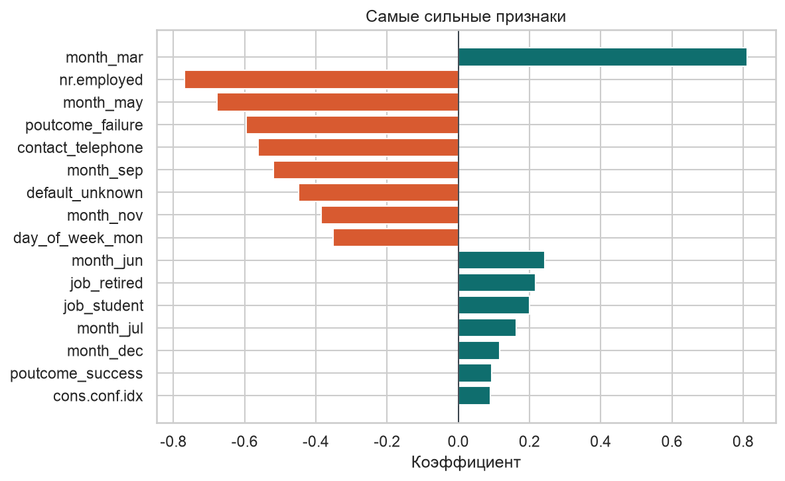

# Кому звонить: логистическая регрессия, максимизирующая прибыль кампании

Учебный пет-проект: модель решает, кому звонить в рамках телефонной кампании банка.
Звонок стоит $2, согласие на срочный депозит приносит $10.


Разбор: [`term_deposit_profit.ipynb`](term_deposit_profit.ipynb).

---

## Что получилось

| | Порог 0.5 (дефолт) | Порог ≈ 0.2 (настроенная) |
|---|---|---|
| Средняя прибыль на фолд | ≈ $1 485 (std ≈ $230) | ≈ $2 700 (std ≈ $300) |
| Расход на операторов | ≈ $640  | ≈ $2418 |
| Средняя выручка на фолд | $2 164  | $5 115 |
| Звонков на фолд | 324  | 1209 |

Прибыль настроенной модели выше **на каждом фолде** (парный t-критерий, p ≈ 0.0012).

Расходы выросли в 3.7 раза, звонков — с 324 до 1 209 на фолд, но выручка выросла быстрее расходов, поэтому прибыль почти удвоилась.






### Самые сильные признаки



- Прошлая кампания. poutcome_success (+) — человеку уже предлагали депозит, и он согласился; poutcome_failure (−0.60) — предлагали, и он отказался. Прошлый отказ устойчиво тянет вниз.
- Канал. Мобильный (contact_cellular, +) против стационарного (contact_telephone, −0.56): мобильный связан с более высокой склонностью.
- Кто клиент. Студенты (job_student, +0.20) и пенсионеры (job_retired, +0.22) — обе группы чаще среднего говорят «да», но коэффициенты маленькие на фоне экономики и волны обзвона.
- Волна обзвона. Месяц без года помечает конкретную волну кампании с её экономическим фоном и составом клиентов, а не «удачный календарный месяц». 

Экономический фон. nr.employed (−0.77) — единственный представитель экономики после удаления дублирующих признаков. Чем ниже занятость, тем чаще берут депозит. Корреляция с согласием около −0.36 — самый большой отрицательный сигнал в модели.

Пропуски в default. default_unknown (−0.45) — клиент не сообщил, был ли у него дефолт. Это поведенческий сигнал («не раскрывает финансовую информацию»), а не финансовый; таких строк около 20%.

---

## Ограничения

- **Случайная кросс-валидация на временных данных.** Кампания шла во времени,
  фолды перемешаны случайно — будущие обзвоны попадают в обучение. Цифры выше —
  оптимистичная верхняя граница; для честной оценки нужен временной сплит.
- **Порог подобран на тех же фолдах, где меряется прибыль.** Лучший порог 0.2 стабилен
  между запусками, но честнее вынести подбор во вложенную CV или отложенную выборку.
- **Только логистическая регрессия.** Бустинг, скорее всего, даст выше AUC; вопрос —
  конвертируется ли это в прибыль при такой асимметрии цен. Следующий эксперимент.
- **Чувствительность к ценам.** При других ценах ($3 за звонок, $8 за депозит)
  оптимальный порог сместится. 

---

## Данные

[UCI Bank Marketing](https://archive.ics.uci.edu/dataset/222/bank+marketing),
файл `bank-additional/bank-additional-full.csv`. В репозиторий не входит.

```bash
wget https://archive.ics.uci.edu/ml/machine-learning-databases/00222/bank-additional.zip
unzip bank-additional.zip
```